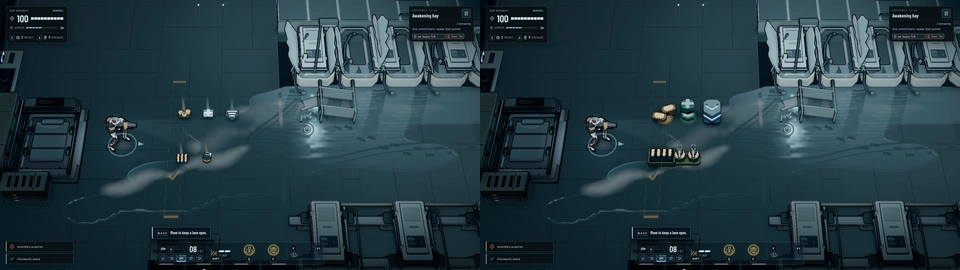
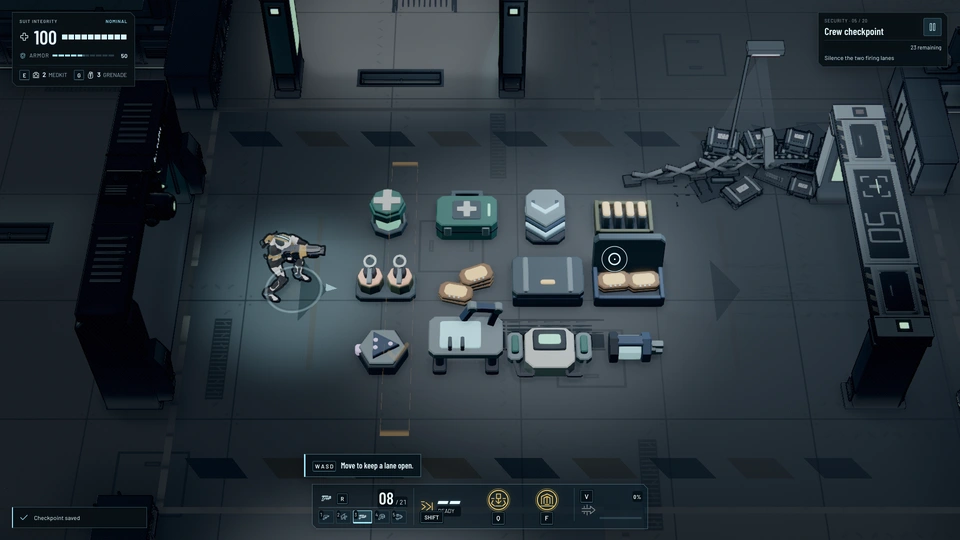
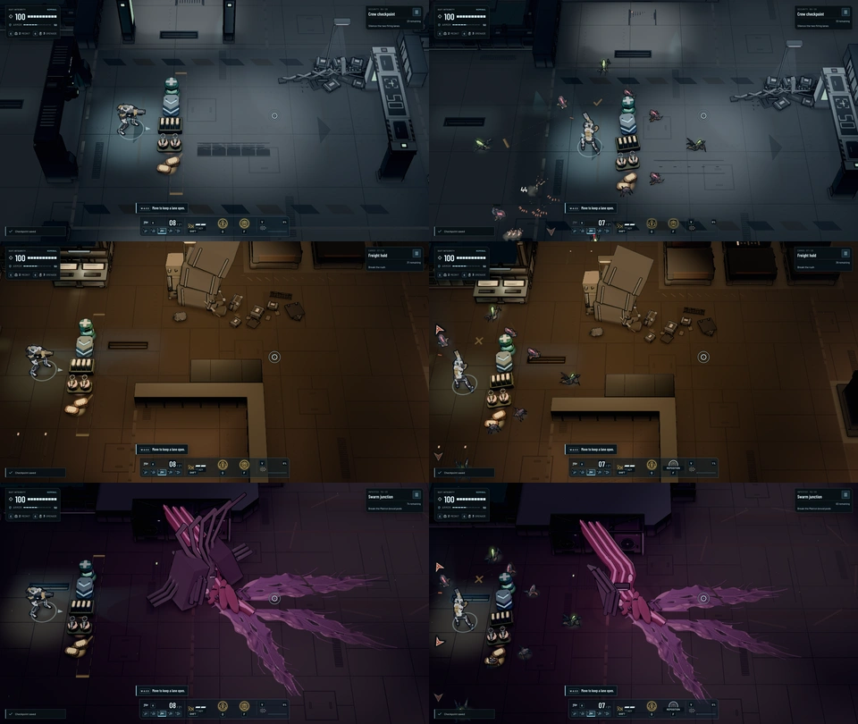

# PROPS14 supply hardware

Five native floor pickups now use original Blender hardware. The same kit supplies seven service, reward and detour subjects, including both states of the salvage cache. The health canister has a twist cap and a lit reservoir. The inventory medkit has a suitcase handle, a clamshell seam and two draw latches.



## Art review

The inspection lineup uses the Crew Checkpoint camera. Its rows show health, medkit, armour and ammo, then grenades, credits and both cache states, then reroll, bench, resuscitator and capacitor. The native drops use their usual hover and rotation. Service-only subjects appear here as a diagnostic arrangement.



The three grey inspection angles exposed a silhouette collision between the upright medicine and capacitor. The capacitor now lies across the deck and has twin blade contacts. The initial turnaround is retained at [24 px](props14/blockout-24.webp), [64 px](props14/blockout-64.webp) and [300 px](props14/blockout-300.webp) per tile.

In the first room pass the ammo cells and pull rings survived reduction, but the cross disappeared into the cap and the top armour plate looked blank. A darker green cap, larger cross and raised cyan chevron addressed those reads. In the second pass the credits still blended into the Freight Hold, so the final wafers have a wider lit contact face. The warm floor remains their weakest background. The selector's triangular dial and the defibrillator leads are clearer at card size. These are visual inspection judgments without timed player recognition data.

Crew Checkpoint, Freight Hold and Swarm Junction appear from top to bottom. Each pair shows the five actual pickup kinds on clear floor and among live enemies, reduced from 1920×1080 to 480×270. The fight fixture advances combat before dropping the row so the native magnet leaves the objects visible for inspection.



## Assets and interface handoff

Both GLBs contain 5,042 high-detail triangles and 2,614 low-detail triangles across twelve assemblies. The entire kit shares a 64×64 base-colour atlas and a 64×64 emission atlas. The meshopt/KTX2 package is 117,692 bytes. The meshopt/PNG fallback is 115,636 bytes. Output hashes are in the [manifest](../../public/assets/props14/manifest.json).

| Subject | High triangles | Low triangles | Transparent 300 px illustration |
|---|---:|---:|---|
| Health canister | 304 | 192 | [health.png](../../public/assets/ui/props14/health.png) |
| Trauma case | 480 | 240 | [medkit.png](../../public/assets/ui/props14/medkit.png) |
| Armour carrier | 268 | 142 | [armor.png](../../public/assets/ui/props14/armor.png) |
| Open ammo crate | 476 | 238 | [ammo.png](../../public/assets/ui/props14/ammo.png) |
| Grenade pair | 540 | 316 | [grenade.png](../../public/assets/ui/props14/grenade.png) |
| Credit wafers | 620 | 310 | [credits.png](../../public/assets/ui/props14/credits.png) |
| Sealed cache | 300 | 150 | [cache-closed.png](../../public/assets/ui/props14/cache-closed.png) |
| Open cache | 664 | 332 | [cache-open.png](../../public/assets/ui/props14/cache-open.png) |
| Requisition selector | 254 | 126 | [reroll.png](../../public/assets/ui/props14/reroll.png) |
| Field workbench | 500 | 250 | [upgrade.png](../../public/assets/ui/props14/upgrade.png) |
| Chest defibrillator | 380 | 190 | [resuscitator.png](../../public/assets/ui/props14/resuscitator.png) |
| Overdrive capacitor | 256 | 128 | [overdrive.png](../../public/assets/ui/props14/overdrive.png) |

Local `nextgen` merged at `e58e99d1`. It had the SVG shop and detour vignettes and no studio command. The transparent ink-contoured Blender renders above are the interface stream's handoff. The live shop and route cards still use their existing illustrations.

## Rebuild

Run from the repository root with Blender and KTX-Software's `toktx` on PATH. Alternatively, set `TOKTX` to the encoder executable. All source geometry and illustrations are original MIT work.

```sh
npm ci
sh tools/assets/props14/rebuild.sh
npm run build
```

The scoped packer writes only under `public/assets/props14/`. Gameplay preparation waits for the loader and registers the instanced finishes with material warmup. Each ground decal draws a resource-coloured centre over a feathered dark contact in one pass. At floor scale, secondary hardware shares enamel colours, which keeps the five-drop frame at its original draw count. The card renders retain the full palette.

## Desktop verification

```sh
npm run capture -- --build --label=props14-shipping --scenarios=g2-pickups,props14-floor,props14-fight --rooms=crew-checkpoint,freight-hold,swarm-junction
npm run capture -- --label=props14-lineup --scenarios=props14-lineup
npm run bench -- --label=props14 --rooms=crew-checkpoint --rigs=arc --tiers=high --repeat=1
npm run playtest -- --rig=breacher --seed=1729 --rooms=5 --fast
```

The paired Awakening Bay captures with all five pickups visible recorded 124 draws before and after. The initial fully textured instanced prototype added two shader programs. The shipping floor geometry groups the atlas faces by enamel finish and uses the retained ship material family.

| Crew Checkpoint, Arc, High, one 20 s trial | Before | Shipping |
|---|---:|---:|
| Peak draws | 155 | 154 |
| Median draws | 127 | 129 |
| 95th-percentile draws | 142 | 143 |
| Retained programs | 136 | 136 |
| Mid-combat program creation | 0 | 0 |
| Peak scene triangles | 489,929 | 510,801 |

Both benchmark runs returned an empty budget-failure list. The trial includes live enemy replenishment and the whole scene. The draw distributions and triangle peaks are single-trial observations. Both builds passed TypeScript and Vite. The seven shipping capture scenarios finished with no page or console errors.

The Breacher campaign at seed 1729 cleared Awakening Bay, Passenger Vault, Residential Gallery, Communal Atrium and Crew Checkpoint. The runner stopped at the requested five-room limit with zero errors.
